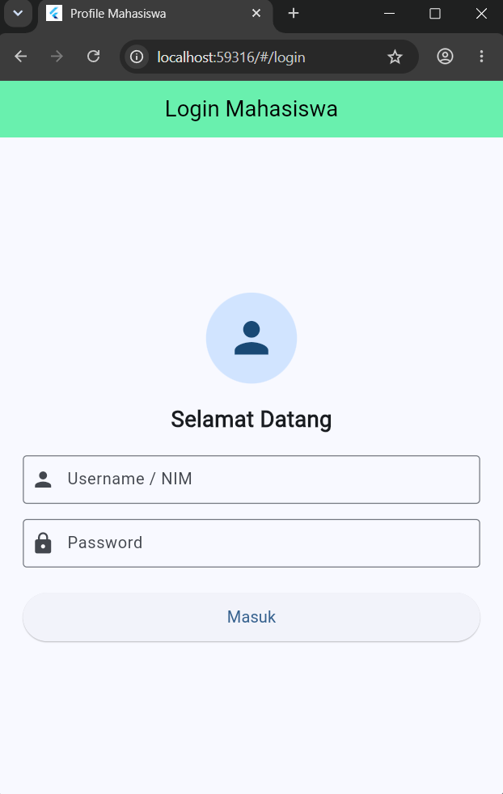
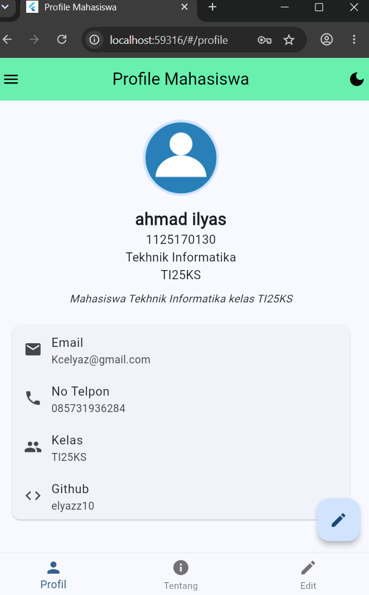
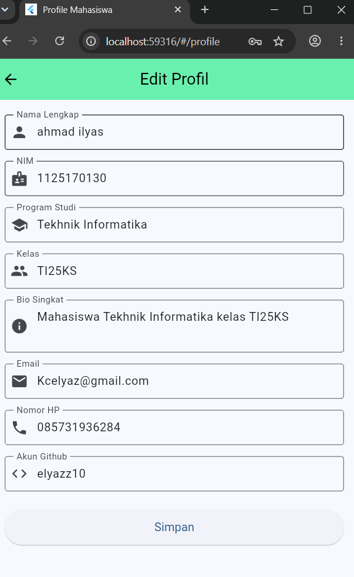

# UTS Pemrograman Mobile

Repositori tugas UTS Pemrograman Mobile.

## Identitas Mahasiswa
- Nama: ahmad ilyas
- NIM: 1125170130
- Kelas: TI25KS
- Prodi: Tekhnik Informatika

## Link Video Presentasi
Link YouTube: [Isi link video disini](https://youtube.com)

## Screenshot Aplikasi
### 1. Halaman Login


### 2. Halaman Profil


### 3. Halaman Edit Profil


## Fitur Aplikasi (Soal 2)
- Halaman Login ada validasi input dan loading
- Halaman Profil ada foto diri dari asset, data diri mahasiswa, dan kontak
- Halaman Edit Profil ada validasi nama, email, nomor hp dan bisa update data ke profil
- Halaman Tentang Saya ada listview hobi dan riwayat sekolah (SMP dan SMK)
- Navigasi ada Drawer, Bottom Navigation Bar, dan tombol Edit (FAB)
- Bisa ubah tema terang dan gelap langsung dari aplikasi
- Nama aplikasi di Android: Profil Ilyas

## Cara Menjalankan
1. Masuk ke folder soal 2:
   ```bash
   cd soal2_profile_app
   ```
2. Jalankan perintah get package:
   ```bash
   flutter pub get
   ```
3. Jalankan aplikasi:
   ```bash
   flutter run
   ```
