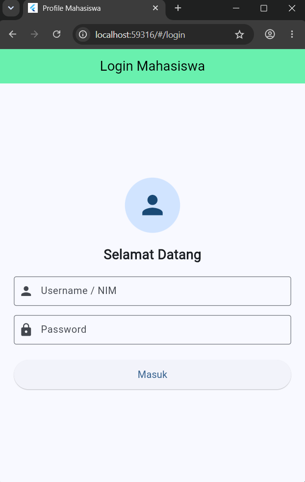
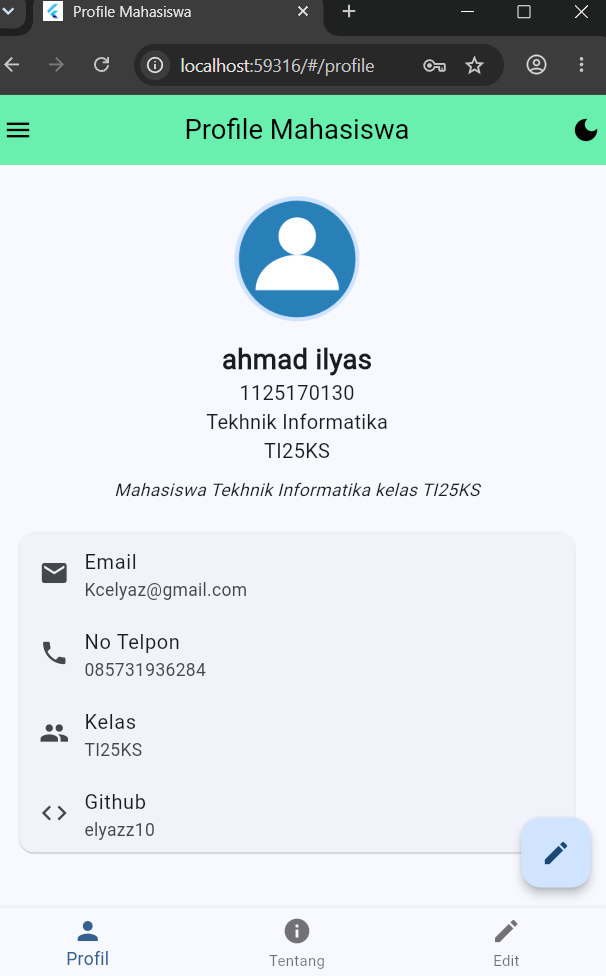
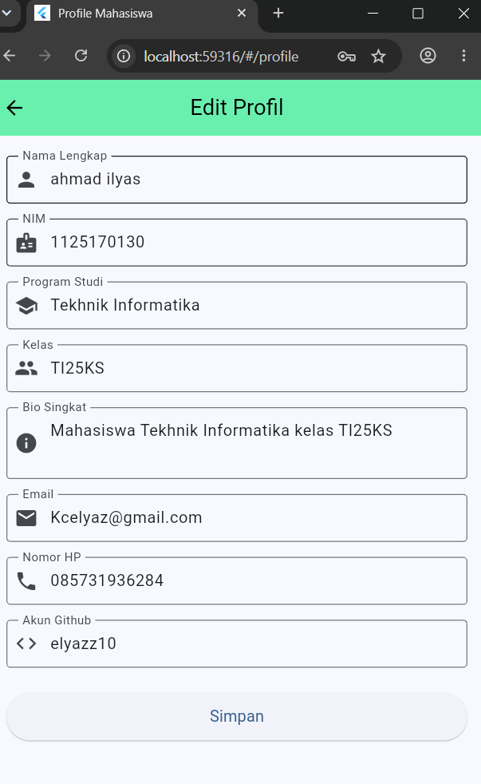

# UTS Pemrograman Mobile - Soal 2 (Profil Mahasiswa)

Aplikasi Flutter Android Profil Mahasiswa yang dibangun sesuai dengan seluruh kriteria dan spesifikasi UTS Pemrograman Mobile.

---

## 📌 Identitas Mahasiswa
* **Nama Lengkap**: ahmad ilyas
* **NIM**: 1125170130
* **Program Studi**: Tekhnik Informatika
* **Kelas**: TI25KS
* **Nama Aplikasi Android**: Profil Ilyas (`android:label="Profil Ilyas"`)

---

## 📺 Link Video Presentasi YouTube
* **URL Video**: [Tonton di YouTube](https://youtu.be/PLACEHOLDER_LINK_ANDA) *(Silakan ganti dengan tautan video presentasi Anda)*

---

## 📸 Tangkapan Layar (Screenshots)

| 1. Halaman Login | 2. Halaman Profil (Terang) | 3. Halaman Edit Profil | 4. Halaman Tentang & Mode Gelap |
| :---: | :---: | :---: | :---: |
|  |  |  |  |

*(Simpan screenshot pengujian Anda pada folder `assets/screenshots/`)*

---

## 🚀 Fitur Aplikasi

1. **Halaman Login (`login_page.dart`)**:
   * Menggunakan pola Materi 5: `StatefulWidget`, `Form` dengan validasi input (NIM/Username & Password min. 6 karakter).
   * Fitur toggle show/hide password.
   * State loading indikator berputar saat proses autentikasi.
   * Navigasi menggunakan `Navigator.pushReplacementNamed` agar pengguna tidak bisa kembali ke login setelah masuk.

2. **Halaman Profil (`profile_page.dart`)**:
   * Menampilkan foto profil lokal dari `assets/images/profile.png` (terdaftar di `pubspec.yaml`) menggunakan `CircleAvatar`.
   * Menampilkan nama lengkap, NIM, prodi, kelas, dan bio singkat.
   * Kontak dan akun (Email, Nomor HP, GitHub) disusun rapi dengan `Card` + `ListTile` + ikon kustom melalui widget reusable `InfoTile`.
   * Langsung merefleksikan perubahan data secara reaktif (`setState`) setelah disimpan dari halaman edit profil.

3. **Halaman Edit Profil (`edit_profile_page.dart`)**:
   * Form pengisian data awal otomatis terisi dari data profil saat ini (`TextEditingController`).
   * **Validasi Lengkap**:
     * Nama: wajib diisi.
     * Email: wajib format email valid (`regex`).
     * Nomor HP: wajib format angka 10–13 digit (`regex`).
   * Tombol Simpan mengembalikan objek profil baru ke halaman utama melalui `Navigator.pop(context, dataBaru)`.

4. **Halaman Tentang Saya (`about_page.dart`)**:
   * Menampilkan minimal 4 keahlian dan hobi favorit dengan ikon dan deskripsi.
   * Menampilkan riwayat jenjang pendidikan formal (SD/SMP/SMK/Universitas).
   * Seluruh komponen disusun rapi dalam `ListView` responsif.

5. **Scaffold Lengkap (Memenuhi 3 Komponen Sekaligus)**:
   * **Drawer**: Menampilkan info header akun, navigasi antarhalaman, toggle mode gelap, dan tombol konfirmasi logout.
   * **BottomNavigationBar**: Navigasi cepat antara tab Profil, Tentang Saya, dan Edit Profil.
   * **FloatingActionButton**: Akses cepat menuju halaman Edit Profil.

6. **Dukungan Tema Terang & Gelap (Theme & DarkTheme)**:
   * Menggunakan Material 3 dengan palet warna konsisten (`colorScheme.fromSeed`).
   * Dilengkapi switch dan tombol pengubah tema langsung di AppBar dan Drawer yang merespon secara instan (`ThemeMode.light` $\leftrightarrow$ `ThemeMode.dark`).

7. **Identitas Native Android**:
   * Atribut `android:label="Profil Ilyas"` pada file `android/app/src/main/AndroidManifest.xml` sehingga nama aplikasi yang terpasang di layar HP Android adalah **Profil Ilyas**.

---

## 📂 Struktur Direktori Kode

```text
soal2_profile_app/
├── android/
│   └── app/src/main/AndroidManifest.xml   # android:label="Profil Ilyas"
├── assets/
│   ├── images/
│   │   └── profile.png                    # Foto diri / avatar
│   └── screenshots/                       # Bukti screenshot untuk laporan & README
├── lib/
│   ├── main.dart                          # MaterialApp, ThemeData, DarkTheme, Routes
│   ├── models/
│   │   └── profile.dart                   # Model data class Profile & initial data
│   ├── screens/
│   │   ├── login_page.dart                # Halaman autentikasi login (Materi 5)
│   │   ├── profile_page.dart              # Halaman profil utama (Drawer, FAB, BottomNav)
│   │   ├── edit_profile_page.dart         # Form edit data dengan validasi & Navigator.pop
│   │   └── about_page.dart                # ListView keahlian, hobi, & riwayat pendidikan
│   └── widgets/
│       └── info_tile.dart                 # Widget kustom reusable untuk kontak/informasi
├── test/
│   └── widget_test.dart                   # Pengujian widget smoke test
└── pubspec.yaml                           # Konfigurasi assets & metadata
```

---

## 🛠️ Cara Menjalankan Aplikasi

1. Masuk ke direktori project:
   ```bash
   cd soal2_profile_app
   ```
2. Unduh dependencies Flutter:
   ```bash
   flutter pub get
   ```
3. Jalankan aplikasi di emulator atau HP Android:
   ```bash
   flutter run
   ```
4. Build APK Release (untuk rilis GitHub):
   ```bash
   flutter build apk --release
   ```
   File APK hasil build akan berlokasi di:
   `build/app/outputs/flutter-apk/app-release.apk`
